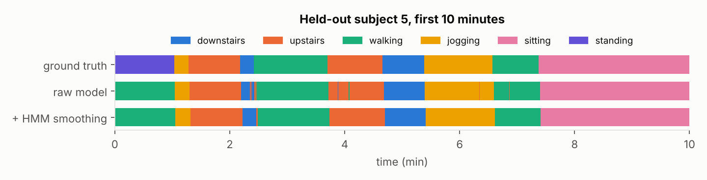
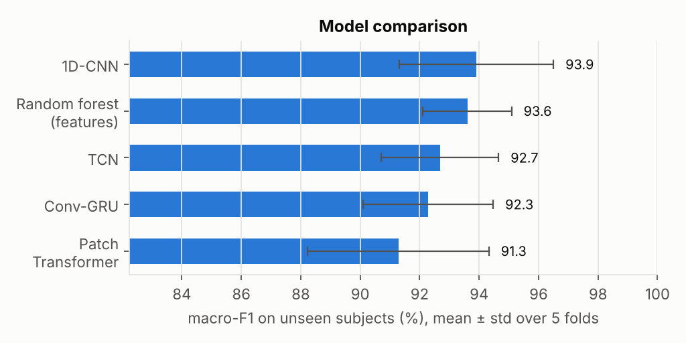
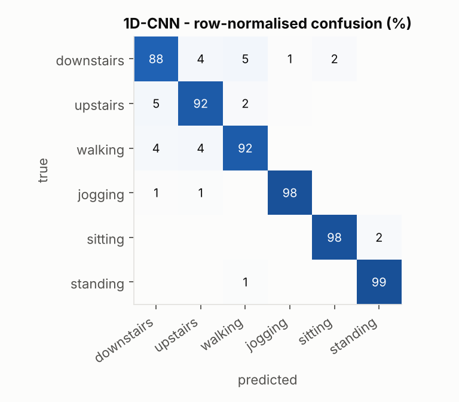
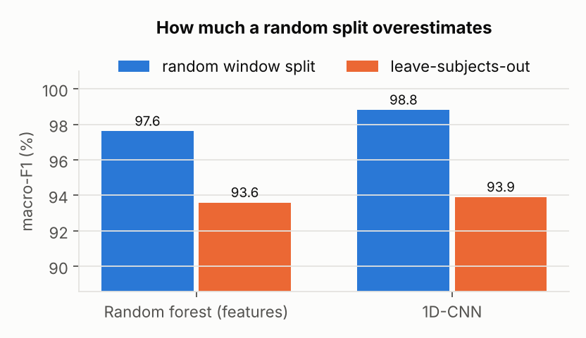
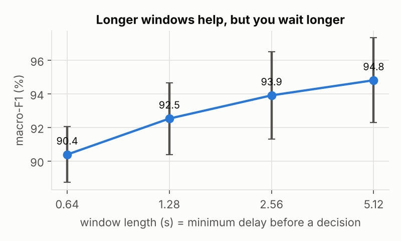
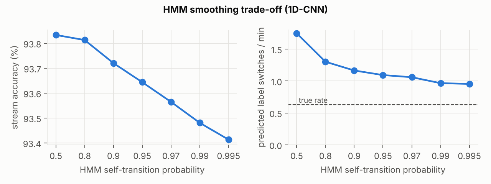
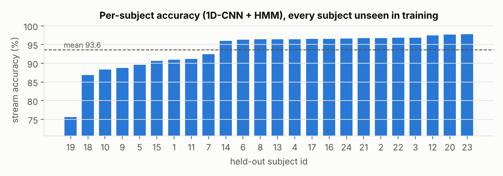

# Real-Time Activity Recognition via Wearable Sensors

Recognising what a person is doing (walking, climbing stairs, jogging, sitting, standing) from the
accelerometer and gyroscope in their phone, in a way that would actually work on a new user, live.

Most HAR repos report 97–99% accuracy. I wanted to find out how much of that survives two things a
real deployment can't avoid:

1. **The user is someone the model has never seen.** Every result here uses leave-subjects-out
   cross-validation: no person appears in both training and test.
2. **Predictions have to be made causally, on a stream.** No looking at the future, a decision every
   0.5 s, and the output should not flicker between labels.


*A held-out subject replayed through the online pipeline. The raw model flickers at activity
changes; the HMM filter removes most of that. It also shows a real failure: this person's standing
segment is called walking for the whole first minute.*

## Main findings

- **Random window splits overestimate performance by 4–5 F1 points.** The same 1D-CNN gets 98.8%
  macro-F1 with the usual shuffled split and 93.9% on unseen subjects. The split also changes the
  ranking: with random splits the CNN clearly beats the random forest (98.8 vs 97.6), but on unseen
  people they are tied (93.9 ± 2.6 vs 93.6 ± 1.5).
- **Bigger or fancier models did not help.** A ~96k-parameter CNN was as good as anything else. The
  TCN, Conv-GRU and patch transformer were all 1–2.5 points worse and had higher variance across folds.
- **The spread between people is larger than the spread between models.** Per-fold F1 for the same
  CNN ranges from 90.1 to 97.2 depending on which subjects are held out.
- **Most errors are stairs.** Jogging, sitting and standing are ~98% F1; downstairs is ~86% and is
  mostly confused with walking and upstairs.
- **Smoothing fixes flicker, not accuracy.** A causal HMM filter cuts label switches per minute
  from 2.9 to 1.1 (ground truth: 0.63) at the cost of ~0.9 s extra delay after a real change.
  Accuracy barely moves: the remaining errors are long, confident mistakes, not noise.
- **Window length is a real trade-off.** 0.64 s windows → 90.4 F1, 2.56 s → 93.9.
  Going to 5.12 s adds another 0.9 points but means waiting 5 s for the first answer.
- **Rotation augmentation is the one that matters.** It adds 2.8 F1 points over no augmentation.
  Jitter + scaling *without* rotation was actually worse than no augmentation at all (89.9 vs 91.1).
- **The gravity vector is essential, attitude hurts.** MotionSense's "user acceleration" has gravity
  removed, so with accelerometer + gyroscope alone sitting and standing are almost indistinguishable
  (84.2 / 88.9 F1). Adding gravity gives 93.9. Adding attitude (roll/pitch/yaw) drops it to 91.1,
  probably because yaw depends on which direction the person is facing.
- **Latency is not the bottleneck.** Every network runs in under 0.5 ms per window on one CPU thread
  through ONNX Runtime, against a 500 ms decision interval. The random forest is the slowest at ~21 ms,
  mostly in tree traversal.

## Setup

```bash
git clone https://github.com/Aranya2801/Real-Time-Activity-Recognition-via-Wearable-Sensors.git
cd Real-Time-Activity-Recognition-via-Wearable-Sensors
python -m venv .venv && source .venv/bin/activate
pip install -r requirements.txt
pip install -e .

python scripts/download_data.py motionsense      # ~75 MB
pytest -q                                         # 18 tests, ~10 s
```

## Reproducing the results

Everything runs on a laptop CPU. On a 2-core machine the main experiment takes about an hour.

```bash
# main table (5-fold leave-subjects-out, all models) - also saves the fold checkpoints
python scripts/run_experiment.py --models rf cnn convgru tcn transformer --tag main --save-models

# random-split comparison
python scripts/run_experiment.py --models rf cnn --split random --tag leak_random

# ablations
python scripts/run_experiment.py --models cnn --window 32  --hop 16 --tag win32
python scripts/run_experiment.py --models cnn --window 64  --hop 32 --tag win64
python scripts/run_experiment.py --models cnn --window 256 --hop 64 --tag win256
python scripts/run_experiment.py --models cnn --sensors acc            --tag sens_acc
python scripts/run_experiment.py --models cnn --sensors acc gyro       --tag sens_acc_gyro
python scripts/run_experiment.py --models cnn --sensors acc gyro grav att --tag sens_all
python scripts/run_experiment.py --models cnn --no-augment             --tag aug_none
python scripts/run_experiment.py --models cnn --rotate-deg 0           --tag aug_norot

# streaming evaluation + latency (need the checkpoints from the main run)
python scripts/stream_eval.py --sweep
python scripts/benchmark_latency.py

# figures and the markdown tables below
python scripts/make_figures.py
```

Raw per-fold results (accuracy, macro-F1, per-class F1, confusion matrices) are in `results/*.json`.

## Data and protocol

**MotionSense** ([Malekzadeh et al., 2019](https://github.com/mmalekzadeh/motion-sense)): iPhone 6s in
the front trouser pocket, 24 subjects (14 male, 10 female, ages 18–46), 50 Hz, six activities.
Each (activity, trial, subject) is one continuous recording, which is what makes the streaming
experiments possible. I use the DeviceMotion data: user acceleration, rotation rate and gravity
(9 channels). Attitude is only used in one ablation.

- Windows: 128 samples (2.56 s), 50% overlap, cut *inside* each recording so no window spans two
  activities. 21,539 windows in total.
- Splits: subjects are shuffled into 5 folds (~5 subjects each). For each fold, 2 of the training
  subjects are held out for early stopping, so the test subjects are never used for model selection.
- Metric: macro-F1 (classes are imbalanced: walking and sitting have ~2.5× more data than stairs).
  Mean ± std over the 5 folds.
- Normalisation statistics come from the training subjects only and are stored inside the model, so
  an exported model takes raw sensor values.

**UCI-HAR** is supported too (`--dataset uci_har`, `python scripts/download_data.py uci_har`), using the
raw inertial signals rather than the 561 pre-computed features. I haven't put UCI-HAR numbers in this
README yet because I want to run them with the same protocol first.

## Models

| Name | What it is | Params |
|---|---|---:|
| `rf` | Random forest (300 trees) on 261 hand-crafted features: time stats, spectral band energies, dominant frequency, entropy, axis correlations, per-sensor magnitude | - |
| `cnn` | 3 conv blocks (64/128/128 filters) + global average pooling | 96k |
| `convgru` | DeepConvLSTM-style: 2 conv layers then a GRU | 71k |
| `tcn` | causal dilated TCN, 4 levels, receptive field 181 samples | 134k |
| `transformer` | patch embedding (8 samples / patch) + 3-layer transformer encoder | 110k |

Training: AdamW, one-cycle LR, label smoothing 0.05, class-weighted loss, up to 30 epochs with early
stopping on validation-subject macro-F1. Augmentation: random 3D rotation of every xyz triplet
(±30°, same rotation for all sensors), per-channel scaling and jitter. The rotation is meant to cover
the fact that everyone's phone sits in their pocket at a slightly different angle.

## Results

### Unseen subjects



| Model | Params | Accuracy (%) | Macro-F1 (%) | CPU latency, 1 window (ms) |
|---|---:|---:|---:|---:|
| 1D-CNN | 96k | 95.0 ± 2.1 | 93.9 ± 2.6 | 0.17 |
| Random forest | - | 94.8 ± 1.4 | 93.6 ± 1.5 | 21.23 |
| TCN | 134k | 94.0 ± 1.6 | 92.7 ± 2.0 | 0.50 |
| Conv-GRU | 71k | 93.6 ± 2.3 | 92.3 ± 2.2 | 0.37 |
| Patch transformer | 110k | 93.0 ± 2.1 | 91.3 ± 3.1 | 0.19 |

Latency is the median for one window, batch size 1, a single CPU thread, through onnxruntime
(for `rf`: feature extraction + predict). Measured on an Intel Xeon @ 2.1 GHz (cloud VM), onnxruntime 1.29. Exported models are 280–550 KB in fp32.
Dynamic int8 quantisation shrank them 2–4× but made them *slower* on this CPU (e.g. CNN 0.17 → 0.67 ms),
since it only quantises the linear layers and adds quantise/dequantise steps around the convolutions.
Static quantisation with calibration data would be the next thing to try.



### Random split vs subject split



| Model | Random window split | Leave-subjects-out | Gap |
|---|---:|---:|---:|
| 1D-CNN | 98.8 ± 0.2 | 93.9 ± 2.6 | 4.9 |
| Random forest | 97.6 ± 0.3 | 93.6 ± 1.5 | 4.0 |

With 50% overlap, every test window shares half its samples with a training window, and the same
person's gait is in both sets. The random split also hides the variance: ±0.2 vs ±2.6.

### Window length



| Window | Seconds | Macro-F1 (%) |
|---:|---:|---:|
| 32 | 0.64 | 90.4 ± 1.7 |
| 64 | 1.28 | 92.5 ± 2.1 |
| 128 | 2.56 | 93.9 ± 2.6 |
| 256 | 5.12 | 94.8 ± 2.5 |

The window length is also the minimum time before the first decision, so for a live app this is a
latency/accuracy knob, not just a hyper-parameter.

### Sensors and augmentation (1D-CNN)

| Setting | Macro-F1 (%) |
|---|---:|
| acc only | 84.2 ± 6.2 |
| acc + gyro | 88.9 ± 0.8 |
| acc + gyro + gravity | 93.9 ± 2.6 |
| acc + gyro + gravity + attitude | 91.1 ± 2.9 |
| no augmentation | 91.1 ± 3.1 |
| jitter + scale, no rotation | 89.9 ± 3.3 |
| jitter + scale + rotation (default) | 93.9 ± 2.6 |

### Streaming

Each held-out subject's recordings are concatenated in random order into one long stream (24 streams,
~7.8 hours, ~56k decisions). The model runs every 25 samples (0.5 s) on the last 2.56 s.
Smoother settings were fixed before looking at the results (EMA α = 0.3, vote over 5, HMM stay = 0.97).

| Smoother | Accuracy (%) | Macro-F1 (%) | Label switches / min | Median delay after a change (s) |
|---|---:|---:|---:|---:|
| none (raw) | 93.8 | 92.4 | 2.91 | 1.4 |
| ema | 93.6 | 92.3 | 1.38 | 2.1 |
| vote | 93.2 | 91.7 | 1.60 | 2.3 |
| hmm | 93.6 | 92.2 | 1.06 | 2.2 |

Ground truth has 0.63 activity changes per minute in these streams. Results for the other models
are in `results/tables.md`; the transformer flickers the most (5.8 switches/min raw).

The HMM is a discrete Bayes filter: the softmax output (from a class-balanced model, so roughly a
likelihood up to a constant) is combined with a "sticky" transition matrix. Its one parameter trades
flicker against delay:



Even at stay = 0.995 the predicted switch rate stays above the true rate. What's left are long
segments that are confidently wrong (like the standing → walking segment in the first figure), which
no amount of temporal smoothing can fix.



Per-subject accuracy (CNN + HMM on the stream) has a median of 96.4%, but subject 19 is at 75.6%.
A model that is "93% accurate" can still be unusable for some people, which an average hides.

## Running it live

Replay a held-out subject through the online predictor in the terminal (the script picks the fold in
which that subject was a test subject):

```bash
python scripts/replay.py --subject 5 --speed 20
```

Or serve the exported ONNX model over a WebSocket. It needs only onnxruntime and numpy, no torch:

```bash
python scripts/benchmark_latency.py        # also writes checkpoints/onnx/*.onnx
uvicorn serve.app:app --port 8000
```

The client sends `{"samples": [[ax, ay, az, gx, gy, gz, grx, gry, grz], ...]}` in any chunk size and
gets back `{"activity": "walking", "confidence": 0.97, "probs": {...}}` every 25 samples. The ring
buffer and HMM state are per connection. `OnlinePredictor` is tested to give exactly the same outputs
as the batched evaluation code.

## Repository layout

```
src/wearhar/
  data.py         MotionSense / UCI-HAR loading, windowing
  splits.py       subject folds, random split (for the comparison)
  features.py     hand-crafted features for the RF baseline
  models.py       CNN, Conv-GRU, TCN, patch transformer + normalisation wrapper
  augment.py      rotation / scaling / jitter
  train.py        training loop, early stopping
  smoothing.py    causal EMA / vote / HMM smoothers (numpy only)
  stream.py       OnlinePredictor, stream building, streaming metrics
  export.py       ONNX export + int8 quantisation
scripts/          experiment runner, stream eval, latency, figures, replay, download
serve/app.py      WebSocket inference server
tests/            unit tests (shapes, causality, splits, online == batched, ONNX round-trip)
results/          json results of every run + tables.md
figures/          generated by scripts/make_figures.py
```

## Limitations

- 24 subjects is small, so fold-to-fold std is large (±2–3 points). Differences under ~1.5 points
  between models are not meaningful here.
- All subjects carried the same phone in the same pocket. The rotation augmentation simulates some
  placement variation, but this says nothing about a phone in a hand or a bag, or about a smartwatch.
- The streams are built by gluing separate recordings together, so transitions are abrupt (jogging
  straight into sitting). Real transitions are gradual and there would also be "other" activities
  that are not in the label set at all.
- Latency is measured on a server CPU, not on a phone.

## Things I'd like to try next

- Per-user calibration: a few seconds of labelled data from a new user to fine-tune the last layer.
  The per-subject plot suggests most of the remaining error is subject-specific.
- An "unknown activity" option (open-set rejection) instead of forcing one of six labels.
- Cross-dataset tests (train on MotionSense, test on UCI-HAR's walking/stairs/sitting/standing).

## References

- M. Malekzadeh, R. G. Clegg, A. Cavallaro, H. Haddadi. *Mobile Sensor Data Anonymization.* IoTDI 2019 (MotionSense dataset).
- D. Anguita, A. Ghio, L. Oneto, X. Parra, J. L. Reyes-Ortiz. *A Public Domain Dataset for Human Activity Recognition Using Smartphones.* ESANN 2013.
- F. J. Ordóñez, D. Roggen. *Deep Convolutional and LSTM Recurrent Neural Networks for Multimodal Wearable Activity Recognition.* Sensors 2016.
- S. Bai, J. Z. Kolter, V. Koltun. *An Empirical Evaluation of Generic Convolutional and Recurrent Networks for Sequence Modeling.* 2018.
- Y. Nie, N. H. Nguyen, P. Sinthong, J. Kalagnanam. *A Time Series is Worth 64 Words (PatchTST).* ICLR 2023.
- N. Y. Hammerla, S. Halloran, T. Plötz. *Deep, Convolutional, and Recurrent Models for Human Activity Recognition Using Wearables.* IJCAI 2016.

## License

MIT
